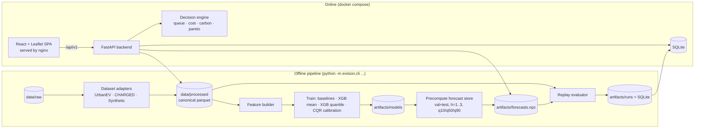
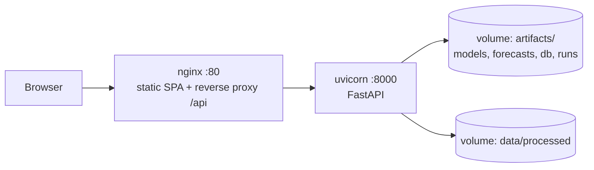

# EVision — Architecture (`architecture.md`)

> Read `specs.md` first (requirements `FR-*`, formulas, API contract). This file defines **how the system is structured**: repo layout, modules and their interfaces, data/DB schemas, algorithms, runtime and deployment. Follow it unless you find a concrete blocker; if you deviate, add an entry to `docs/decisions.md` (ADR-style, 3 lines).

**Design principle: simple and minimal.** Plain functions and small dataclasses. No plugin frameworks, no dependency-injection containers, no metaclasses. Add an abstraction only when two real implementations exist (e.g. dataset adapters, carbon providers, forecast store).

---

## 1. System overview



Two worlds share the same Python package `evision`:
1. **Offline pipeline** (CLI): data → features → models → forecast store → replay evaluation → results in SQLite/parquet.
2. **Online app**: FastAPI reads precomputed artifacts and calls the **same decision engine code** the replay uses (single implementation → what is evaluated is what is served).

**Key invariant:** `decision/engine.py` is a pure, deterministic module (no I/O). Both the API and the replay evaluator call it with a `ForecastView` and a `HistoryView`.

---

## 2. Repository layout

```
evision/
├── README.md                      # quickstart
├── specs.md  architecture.md  plan.md          # these docs (copy into docs/spec/ too)
├── AGENTS.md                      # 10-line pointer: read specs → architecture → plan; rules from plan.md §0
├── Makefile
├── pyproject.toml                 # backend package + extras: [lstm] [osm] [dev]
├── uv.lock | requirements.lock
├── .env.example  .gitignore  .editorconfig
├── configs/
│   ├── default.yaml
│   └── carbon_profiles.yaml
├── design/inspiration/            # TEAM-PROVIDED IMAGES (frontend reference)
├── data/{raw,processed}/          # gitignored
├── artifacts/                     # gitignored: models/, forecasts/, runs/, reports/, db/evision.sqlite
├── backend/
│   ├── evision/
│   │   ├── config.py              # load YAML + env → Settings (pydantic)
│   │   ├── cli.py                 # Typer: download, prepare, train, calibrate, precompute, evaluate, cross-city, seed-db, reproduce
│   │   ├── types.py               # dataclasses: Station, Candidate, Option, Forecast, Params
│   │   ├── data/
│   │   │   ├── schema.py          # canonical column names + validators
│   │   │   ├── adapters/{base.py, urbanev.py, charged.py, synthetic.py}
│   │   │   ├── quality.py         # data-quality report
│   │   │   ├── split.py           # chronological split
│   │   │   ├── store.py           # DataStore: loads parquet → numpy panels (time × station)
│   │   │   └── history.py         # HistoryView + LeakageError
│   │   ├── features/
│   │   │   └── build.py           # build_features(store, t_idx_range, h, groups)
│   │   ├── forecasting/
│   │   │   ├── baselines.py       # persistence, historical average
│   │   │   ├── xgb_model.py       # mean + quantile models per horizon
│   │   │   ├── conformal.py       # CQR calibration
│   │   │   ├── ensemble.py        # optional K-model spread
│   │   │   ├── lstm_model.py      # optional (torch import guarded)
│   │   │   ├── metrics.py         # MAE RMSE sMAPE R2 coverage width pinball
│   │   │   ├── registry.py        # save/load models + metadata
│   │   │   ├── train.py           # train_all(), ablation()
│   │   │   └── store.py           # ForecastStore (precompute + lookup + live fallback)
│   │   ├── decision/
│   │   │   ├── queueing.py        # erlang_c_wait()
│   │   │   ├── geo.py             # haversine, travel time (OSMnx optional)
│   │   │   ├── carbon.py          # ScenarioCarbonProvider, ElectricityMapsProvider
│   │   │   ├── costs.py           # price, carbon, generalised cost
│   │   │   ├── candidates.py      # generate_candidates()
│   │   │   ├── pareto.py          # pareto_front(), label_options()
│   │   │   ├── engine.py          # recommend(): the one entry point
│   │   │   └── explain.py         # templated explanations
│   │   ├── evaluation/
│   │   │   ├── strategies.py      # 6 strategies + oracle
│   │   │   ├── replay.py          # replay loop
│   │   │   ├── metrics.py         # regret, imbalance, failure rate
│   │   │   ├── stats.py           # paired bootstrap
│   │   │   ├── sensitivity.py
│   │   │   ├── cross_city.py
│   │   │   ├── insights.py        # utilisation, over/under-used stations
│   │   │   └── report.py          # figures (matplotlib/plotly) + report.md
│   │   ├── db/{models.py, session.py, seed.py}      # SQLAlchemy 2.0 + SQLite
│   │   └── api/
│   │       ├── main.py            # app factory, CORS, logging, error handlers, lifespan loads store/models
│   │       ├── deps.py            # get_state(), get_db()
│   │       ├── schemas.py         # Pydantic request/response models
│   │       └── routes/{health.py, meta.py, stations.py, recommend.py, evaluation.py, insights.py, queueing.py}
│   └── tests/
│       ├── fixtures/              # tiny synthetic dataset (≤ 2 MB)
│       ├── unit/ integration/ api/ leakage/
├── scripts/                       # thin wrappers around cli (download_data.py, bootstrap.sh)
├── notebooks/                     # 01_eda.ipynb (optional, reproducible from processed data)
├── frontend/
│   ├── package.json  vite.config.ts  tailwind.config.ts  tsconfig.json
│   └── src/
│       ├── main.tsx  App.tsx  routes.tsx
│       ├── api/{client.ts, types.gen.ts, hooks.ts}
│       ├── state/appState.ts      # tiny zustand store: asOf, origin, prefs, selectedOption
│       ├── styles/{tokens.css, globals.css}
│       ├── components/{map/, cards/, charts/, panels/, layout/, common/}
│       ├── pages/{Recommend, StationDetail, Compare, Evaluation, Insights, About}.tsx
│       ├── lib/{format.ts, colors.ts, time.ts}
│       └── tests/
├── deploy/
│   ├── Dockerfile.backend  Dockerfile.frontend  nginx.conf
│   ├── docker-compose.yml  docker-compose.dev.yml
│   └── render.yaml | fly.toml (optional examples)
├── docs/{data.md, assumptions.md, design-notes.md, deployment.md, results.md, decisions.md}
└── .github/workflows/ci.yml
```

---

## 3. Technology choices (pin exact versions when generating the lock file)

| Layer | Choice | Notes |
|---|---|---|
| Python | 3.11 | |
| Data | pandas 2.x, NumPy, pyarrow, GeoPandas (station geometry, bbox) | Parquet on disk, `float32` where possible |
| ML | scikit-learn, **XGBoost ≥ 2.0** (needed for `reg:quantileerror`), optional PyTorch (CPU) | `tree_method="hist"` |
| Queue/decision | pure NumPy | no OR-Tools required (Pareto filter is O(n²) on ≤ 60 points); OR-Tools stays optional/unused |
| Geo | haversine (own function); optional OSMnx + NetworkX | `[osm]` extra |
| API | FastAPI, Uvicorn, Pydantic v2 | `slowapi` or tiny custom limiter |
| DB | SQLite via SQLAlchemy 2.0 | PostgreSQL + PostGIS = documented scale-up path only |
| CLI | Typer | |
| Reports | Matplotlib (static PNG), Plotly (optional HTML) | |
| Tests/lint | pytest, pytest-cov, hypothesis (small use), ruff, mypy | |
| Frontend | React 18, TypeScript, Vite, Tailwind, react-leaflet, Recharts, TanStack Query, React Router, zustand, Lucide icons | `openapi-typescript` for types |
| Deploy | Docker, docker-compose, nginx | |

---

## 4. Data architecture

### 4.1 Canonical files (`data/processed/<dataset>/`)
See `specs.md §5.1`. Additional derived files:
- `panel.npz` : dense arrays built once by `DataStore` for speed — `occ_rate[T,S] float32`, `occ_count[T,S]`, `e_price[T,S]`, `s_price[T,S]`, `volume[T,S]`, `duration[T,S]`, `weather[T,F]`, `ts[T]`, `station_ids[S]`, `capacity[S]`, `lat[S]`, `lon[S]`, `neighbour_idx` (ragged → padded `[S,K]` with -1).
- `split.json`: `{train:[t0,t1], val:[t0,t1], test:[t0,t1]}` as index + ISO timestamp.

### 4.2 `DataStore`
```python
class DataStore:
    ts: np.ndarray            # [T] datetime64[h]
    stations: pd.DataFrame
    occ_rate: np.ndarray      # [T,S] float32, NaN for missing
    ...
    def view(self, t_idx: int) -> HistoryView: ...
    def tariff(self, t_idx: int) -> np.ndarray: ...   # prices allowed for future buckets (A6)
```
`HistoryView(store, t_idx)` exposes **only** `occ_rate[: t_idx+1]` etc. Accessing `view.occ_rate[t_idx+1]` or calling `view.at(k)` with `k > t_idx` raises `LeakageError`. Implementation: store arrays in the view as read-only slices (`arr[: t_idx+1]`, `flags.writeable=False`) so out-of-range index gives `IndexError` which is wrapped; plus an explicit `.at(k)` accessor that raises `LeakageError`. Keep this tiny (≈ 40 lines).

### 4.3 SQLite schema (`artifacts/db/evision.sqlite`)
Raw time series stay in parquet/numpy (too large and read-only). SQLite holds **metadata, experiment results and app logs**:

```sql
CREATE TABLE stations (station_id TEXT PRIMARY KEY, name TEXT, lat REAL, lon REAL, capacity INT,
                       dataset TEXT, city TEXT, mean_price REAL, tau_h REAL, avg_power_kw REAL);

CREATE TABLE model_registry (model_id TEXT PRIMARY KEY, kind TEXT, horizon INT, created_at TEXT,
                             config_hash TEXT, data_hash TEXT, metrics_json TEXT, path TEXT, is_active INT);

CREATE TABLE forecast_cache (as_of TEXT, station_id TEXT, horizon INT, q10 REAL, q50 REAL, q90 REAL,
                             raw_q10 REAL, raw_q90 REAL, point REAL, model_id TEXT,
                             PRIMARY KEY (as_of, station_id, horizon));   -- lazily filled for LIVE fallback only

CREATE TABLE experiment_runs (run_id TEXT PRIMARY KEY, created_at TEXT, dataset TEXT, setting TEXT,
                              config_json TEXT, config_hash TEXT, data_hash TEXT, git_sha TEXT, notes TEXT);

CREATE TABLE experiment_metrics (run_id TEXT, strategy TEXT, subset TEXT,      -- subset: all | high_unc | normal
                                 metric TEXT, value REAL, ci_lo REAL, ci_hi REAL,
                                 PRIMARY KEY (run_id, strategy, subset, metric));

CREATE TABLE decisions (run_id TEXT, decision_id INT, t_idx INT, origin_lat REAL, origin_lon REAL,
                        strategy TEXT, station_id TEXT, delay_min INT, wait_pred REAL, wait_real REAL,
                        cost_real REAL, regret REAL, interval_width REAL, failed INT,
                        PRIMARY KEY (run_id, decision_id, strategy));
CREATE INDEX idx_decisions_run ON decisions(run_id, strategy);

CREATE TABLE forecast_eval (run_id TEXT, model TEXT, horizon INT, subset TEXT, metric TEXT, value REAL);
CREATE TABLE ablation (run_id TEXT, kind TEXT, variant TEXT, horizon INT, metric TEXT, value REAL);  -- kind: forecast|decision
CREATE TABLE sensitivity (run_id TEXT, param TEXT, value TEXT, strategy TEXT, metric TEXT, result REAL);
CREATE TABLE cross_city (run_id TEXT, train_city TEXT, test_city TEXT, strategy TEXT, metric TEXT, value REAL);
CREATE TABLE request_log (ts TEXT, path TEXT, status INT, ms REAL, request_id TEXT);
```
Migrations: keep simple — `Base.metadata.create_all()` in `seed-db`; if schema changes, bump `SCHEMA_VERSION` constant and rebuild (DB is derived data).

---

## 5. Feature engineering (`features/build.py`)

Function signature:
```python
def build_features(store: DataStore, t_idx: np.ndarray, h: int, groups: set[str]) -> tuple[pd.DataFrame, np.ndarray]:
    """Return X (rows = (t, station) pairs) and y = occ_rate[t+h]. All inputs use buckets <= t, except tariff[t+h]."""
```
Feature groups (for ablation): `time`, `occupancy` (lags/rolling/trend, always on except "time-only" ablation), `weather`, `price`, `spatial` (capacity, lat/lon, neighbour mean at t, station mean-price).
- Vectorised with NumPy by building `[T,S]` arrays shifted via slicing; stack to long format; drop rows with NaN target or `t < min_history_h`.
- Drop target-leaking columns explicitly; unit test compares features computed on truncated vs full data.
- `station_id` as a categorical is **not** used (keeps the model city-transferable); use static features instead.

---

## 6. Forecasting architecture

```python
# forecasting/xgb_model.py  (simple, explicit)
def train_mean(X_tr, y_tr, X_va, y_va, seed) -> xgb.XGBRegressor
def train_quantile(X_tr, y_tr, X_va, y_va, quantiles, seed) -> xgb.XGBRegressor   # multi-quantile, objective reg:quantileerror

# forecasting/conformal.py
def fit_cqr(q_lo_val, q_hi_val, y_val, alpha) -> float        # returns correction Qhat
def apply_cqr(q_lo, q_hi, qhat) -> tuple[np.ndarray, np.ndarray]
```
CQR: scores `s_i = max(q_lo_i − y_i, y_i − q_hi_i)`; `Qhat` = the `⌈(n+1)(1−α)⌉/n` empirical quantile of `s`; calibrated interval `[q_lo − Qhat, q_hi + Qhat]`, clipped to `[0,1]`. Calibrate **per horizon** on validation only. (Note in docs: time-series data are not exchangeable, so coverage is approximate; check empirical coverage on test.)

Training procedure `train_all()`:
1. For each `h ∈ horizons`: build train/val features → train `mean` and `quantile` models with early stopping on val.
2. Calibrate CQR on val → store `qhat[h]`.
3. Evaluate on val + test (metrics, coverage, width) → registry.
4. Run feature-group ablation (retrains small models, `n_estimators` capped for speed).
5. Baselines evaluated with identical rows.

`ForecastStore` (precomputed):
```python
class ForecastStore:
    # arrays over the evaluation window [t_start..t_end] only (val+test)
    point:  np.ndarray  # [Tw, S, H]
    q10, q50, q90: np.ndarray  # [Tw, S, H]   calibrated
    raw_q10, raw_q90: np.ndarray
    hist_avg: np.ndarray       # [Tw, S, H] expanding-window historical average using data <= t
    def get(self, t_idx: int) -> ForecastView   # arrays for all stations at t
```
Persist as `artifacts/forecasts/<dataset>.npz` with a header (model ids, split hash). API loads it into memory at startup (~100 MB worst case at float32). A `LiveForecastService` (P1) can compute forecasts for arbitrary `t_idx ≥ min_history_h` using the saved models (build features for that single `t` across all stations → predict) and writes to `forecast_cache`.

Important: `hist_avg` must be computed with an **expanding** window (data ≤ t), cumulative sums by hour-of-week — vectorised and leakage-tested.

---

## 7. Decision engine architecture

Pure functions; all arrays vectorised over candidates.

```python
# decision/queueing.py
def erlang_c_wait_min(c: np.ndarray, tau_h: np.ndarray, occupied: np.ndarray,
                      rho_max: float = 0.98, w_max_min: float = 60.0) -> tuple[np.ndarray, np.ndarray]:
    """Return (wait_min, saturated_flag). Vectorised Erlang-B recursion up to max(c)."""
```
Reference implementation (keep this shape; it is tiny and testable):
```python
def erlang_c_wait_min(c, tau_h, occupied, rho_max=0.98, w_max_min=60.0):
    c = np.asarray(c, float); tau = np.asarray(tau_h, float)
    a = np.minimum(np.asarray(occupied, float), rho_max * c)       # offered load (Erlangs)
    b = np.ones_like(a)                                            # Erlang-B recursion
    for k in range(1, int(c.max()) + 1):
        nb = a * b / (k + a * b)
        b = np.where(k <= c, nb, b)                                # only advance while k <= c_i
    rho = a / c
    p_wait = b / (1.0 - rho * (1.0 - b))
    wait_h = p_wait * tau / (c - a)
    wait_min = np.minimum(60.0 * wait_h, w_max_min)
    saturated = (occupied >= rho_max * c) | (wait_min >= w_max_min)
    return np.where(a <= 0, 0.0, wait_min), saturated
```

```python
# decision/candidates.py
@dataclass
class Candidate: station_idx:int; delay_h:int; travel_km:float; travel_min:float; required_h:int

def generate_candidates(origin, store_stations, params) -> list[Candidate]
```

```python
# decision/engine.py
@dataclass
class Params: energy_kwh, radius_km, delays_h, risk_kappa, vot_per_h, carbon_price, carbon_scenario, strategy, ...
def recommend(origin, t_idx, view: ForecastView, tariff, stations, params, carbon: CarbonProvider) -> Recommendation
```
Steps inside `recommend()` (single code path for API + replay):
1. `cands = generate_candidates(...)`.
2. Gather forecast quantiles for each candidate at `required_h` (`view.q10/q50/q90[station, required_h-1]`, or `point`/`current`/`hist_avg` depending on `strategy`).
3. `o_eff` by strategy (specs §5.4) → `erlang_c_wait_min` for point/lower/upper → `wait_min`, `wait_interval`.
4. Costs (`costs.py`): price from tariff at charge hour, carbon from provider at charge hour, `total_time_min`, `generalised_cost`.
5. `pareto_front()` on `(total_time_min, price_total, carbon_kg)`; `label_options()` → FASTEST/BALANCED/GREENEST (deterministic tie-breaks).
6. `explain.py` builds the explanation payload (no LLM).
Returns `Recommendation(options, pareto, dominated, params_used)`; the API serialises it via `schemas.py`.

Strategies `nearest` and `cheapest` bypass steps 2–5 for selection but still compute the same descriptive fields so the UI can show them.

Pareto filter (simple O(n²)):
```python
def pareto_mask(F: np.ndarray) -> np.ndarray:           # F: [n, m] to minimise
    n = len(F); keep = np.ones(n, bool)
    for i in range(n):
        dominated = np.all(F <= F[i], axis=1) & np.any(F < F[i], axis=1)
        if dominated.any(): keep[i] = False
    return keep
```

Carbon providers:
```python
class CarbonProvider(Protocol):
    source: str                                  # "scenario" | "observed"
    def intensity_g_per_kwh(self, ts: datetime, scenario: str) -> float: ...
```
`ScenarioCarbonProvider` reads `configs/carbon_profiles.yaml`. `ElectricityMapsCarbonProvider` is optional; if token absent it is never constructed. API always reports `carbon_source`.

---

## 8. Evaluation (replay) architecture

```python
# evaluation/replay.py
def run_replay(store, fstore, params, eval_cfg, setting) -> ReplayResult:
    for t_idx in decision_times(split.test, eval_cfg.hours):
        view = store.view(t_idx)                      # HistoryView (leakage guard)
        fview = fstore.get(t_idx)                     # forecasts made with data <= t_idx
        for origin in sample_origins(rng(seed, t_idx), n):
            cands = generate_candidates(...)          # shared across strategies
            choices = {s.name: s.choose(origin, cands, view, fview, tariff) for s in strategies}   # FROZEN
            truth = reveal(store, t_idx, cands)       # accessed only AFTER choices are made
            record(choices, truth)
```
- `reveal()` is the **only** function allowed to read `store` beyond `t_idx`; located in `replay.py`; unit-tested to be called after `choose`.
- Realised outcomes vectorised for all candidates: `wait_real = erlang_c_wait_min(c, tau, occ_true[arrival_idx])`, `cost_real`, `C_real`.
- `oracle` = argmin `C_real` (regret 0).
- Metrics in `metrics.py` operate on a tidy `decisions` DataFrame (one row per decision × strategy). `stats.py`: paired bootstrap on per-decision regret differences (`np.random.default_rng(seed)`).
- Sampling: `sample_origins` picks a random station (uniform) per origin and jitters up to 1.5 km; seeded by `(global_seed, t_idx)` for determinism regardless of iteration order.
- Runtime budget: precomputed forecasts + vectorised candidates keep 650 h × 20 origins × 6 strategies manageable; if slow, parallelise over `t_idx` with `concurrent.futures` (results sorted afterwards for determinism).
- Outputs: `decisions.parquet`, `metrics.json`, figures, `report.md`; `seed-db` loads them into SQLite.

---

## 9. API architecture

- `create_app()` factory; lifespan loads `Settings`, `DataStore`, `ForecastStore`, `Registry`, SQLite engine into `app.state.ctx` (a plain dataclass `AppContext`).
- Routes are thin: validate → call into `evision.decision` / read DB → serialise. No business logic in routes.
- Time handling: API accepts `as_of` and snaps to the **hour bucket**; valid range = `[val_start + warm-up, test_end]` (replay mode). Outside → 422 with a helpful message.
- `reveal` endpoints only allowed where `as_of + h ≤ last timestamp`.
- Middleware: request id, access log, CORS allow-list, simple per-IP rate limit on `POST` routes, global exception handler → `{"error": {...}}`.
- `GET /stations` is the hot path: build response from numpy arrays (no per-row ORM) and cache by `as_of` (LRU, 64 entries).
- OpenAPI schema exported at build (`scripts/export_openapi.py`) → frontend `npm run gen:api`.
- Synthetic mode: `meta.data_source == "synthetic"`; UI shows a banner.

---

## 10. Frontend architecture

- **State**: tiny zustand store `{asOf, origin, prefs, selectedOptionId, layer}`; server state via TanStack Query (keys include `asOf`, `origin`, `prefs`; `staleTime` 5 min; debounced origin changes 300 ms).
- **Routing**: `/`, `/station/:id`, `/compare`, `/evaluation`, `/insights`, `/about`.
- **Layout**: `AppShell` (top bar with dataset badge + synthetic banner, theme toggle, nav) + page content.
- **Key components** (each ≤ ~150 lines, props typed):
  - `MapView` (react-leaflet): tile layer (OSM, attribution required), `StationMarkers` (canvas renderer for ~1.4k points; colour by occupancy layer), `OriginPin` (draggable), `RadiusCircle`, `RouteLine` (straight line origin→station, labelled "approx").
  - `TimeMachine`: datetime slider limited to `meta.ranges.test`, play/step buttons (±1 h).
  - `PreferencesPanel`: sliders/inputs mapped to `Params`.
  - `OptionCard` ×3, `ConfidenceBadge`, `AssumptionBadge` (for carbon).
  - `ExplanationDrawer`: `CostBreakdownBar`, `ForecastBandChart`, `QueueSteps`.
  - `TradeoffChart` (Recharts `ScatterChart` + line for Pareto front).
  - `RevealPanel`.
  - Evaluation: `StrategyTable`, `RegretBars` (with CI whiskers), `ReliabilityPlot`, `AblationTable`, `SensitivityLines`, `CrossCityTable`.
  - Insights: `UtilisationHeatmap` (CSS grid), `RankingTable`.
- **Theming**: only CSS variables from `tokens.css`; Tailwind config maps `colors.brand.*` etc. to variables; dark/light via `data-theme`.
- **Accessibility**: keyboard-reachable markers list as alternative to map (a "list view" toggle), ARIA live region for result updates.
- **Error/empty/loading**: shared `<QueryState>` wrapper.
- **Build**: Vite production build → nginx static; `VITE_API_BASE=/api/v1` (proxied by nginx).

---

## 11. Deployment architecture



- `Dockerfile.backend`: multi-stage; python:3.11-slim; install from lock; **no torch** unless `--build-arg WITH_LSTM=1`; run as non-root; `CMD uvicorn evision.api.main:create_app --factory --host 0.0.0.0 --port 8000 --workers 2`.
- `Dockerfile.frontend`: node:20 build stage → nginx:alpine; `nginx.conf` serves SPA (history fallback) and proxies `/api/` to `backend:8000`; gzip + cache headers for hashed assets.
- `docker-compose.yml`: services `backend`, `frontend`, optional one-shot `bootstrap` (profile `bootstrap`) that runs `evision reproduce`; volumes `artifacts` and `data`; healthchecks (`/api/v1/health`); `env_file: .env`.
- **Artifact shipping**: models + forecasts + db + processed panel are zipped by `make bundle` → `evision-artifacts.tar.gz` (a few hundred MB at most). Deployment = unzip into volume. Because raw data licences must be respected, the bundle holds derived artifacts only; document this in `docs/deployment.md`.
- **Configuration via env**: `EVISION_CONFIG`, `EVISION_DATA_DIR`, `EVISION_ARTIFACTS_DIR`, `EVISION_CORS_ORIGINS`, `EVISION_LOG_LEVEL`, `ELECTRICITYMAPS_TOKEN` (optional).
- **TLS**: terminated by the host (Caddy/Traefik/cloud LB); sample Caddyfile in `docs/deployment.md`.
- **CI** (`.github/workflows/ci.yml`): jobs `backend` (ruff, mypy, pytest with synthetic fixtures), `frontend` (lint, tsc, vitest, build), `docker` (build both images, run `/health` smoke test with synthetic bundle).

---

## 12. Cross-cutting concerns

| Concern | Approach |
|---|---|
| Determinism | `seed_everything(42)`; `n_jobs` fixed; sort before aggregation; hash configs/data; run-twice test in CI on synthetic data. |
| Logging | `logging` JSON formatter; request ids; CLI shows progress with `rich`/`tqdm`. |
| Errors | Domain errors (`LeakageError`, `DataNotReady`, `NoCandidates`) mapped to HTTP codes in one handler. |
| Config | Single `Settings` object; no `os.environ` reads outside `config.py`. |
| Types | Typed function signatures; `mypy --strict` on `decision/` and `evaluation/`. |
| Docs generation | `evaluate` writes `docs/results.md` from `metrics.json` (template + numbers) so the report never drifts from the data. |
| Licence & attribution | Dataset citations in `docs/data.md` and About page; OSM tile attribution in map. |

---

## 13. Architecture decision records (initial)

| # | Decision | Why |
|---|---|---|
| D1 | Single decision-engine code path for API and replay | Evaluate exactly what is served |
| D2 | Precomputed forecast store for val+test; live inference optional | Fast API, fast replay, leak-safe |
| D3 | Occupancy **rate** as target; global XGBoost per horizon | Scale-free, one model for all stations |
| D4 | Direct multi-horizon (3 models) instead of recursive | No error accumulation, simpler |
| D5 | CQR on validation set; ensemble optional | Valid-ish intervals with minimal code |
| D6 | M/M/c Erlang-C with ρ cap and 60-min wait cap | Explainable, handles censored occupancy |
| D7 | Realised wait computed with same M/M/c on true occupancy | No queue logs exist (A4); documented limitation |
| D8 | Parquet/NumPy for time series; SQLite for metadata/results | Simple, fast, portable |
| D9 | Haversine×detour default; OSMnx optional | No heavy graph downloads by default |
| D10 | Time Machine UI instead of fake "live" data | Honest replay semantics |
| D11 | Synthetic adapter as fallback and CI fixture | System always runs end-to-end |
| D12 | Frontend styling only via tokens from inspiration images | Easy re-skin, consistent look |
