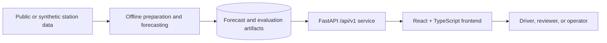

# EVision system architecture

**Status:** Active target architecture  
**Audience:** Engineering and reviewers  
**Principle:** Keep data preparation, decision logic, API transport, and presentation independently replaceable.

## 1. System context



The current repository implements the UI and mock service boundary. The backend and offline pipeline are the next integration boundary; they must not leak into components.

## 2. Repository boundaries

```text
frontend/src/
├── main.tsx          Route composition, page components, typed mock data
├── styles/           Dashboard, brand, landing, and motion styles
└── vite-env.d.ts     Vite type declarations

frontend/public/      Static browser assets
scripts/media/        Developer-only media preparation utilities
```

Generated output such as `frontend/dist/` and dependencies such as `frontend/node_modules/` are build products, not source.

## 3. Frontend layers

1. **Routing:** maps URL paths to product pages.
2. **Page composition:** assembles dashboard, detail, compare, evaluation, insights, about, and landing experiences.
3. **Presentation:** cards, maps, charts, drawers, navigation, and responsive shells.
4. **Service boundary:** typed local data today; replaceable API calls tomorrow.
5. **Design system:** tokens, glass surfaces, typography, focus states, responsive rules, and reduced-motion behavior.

## 4. API boundary

```text
GET  /api/v1/stations
GET  /api/v1/stations/:id
POST /api/v1/recommend
POST /api/v1/recommend/compare
GET  /api/v1/evaluation/*
GET  /api/v1/insights/utilisation
```

The mock layer must remain contract-shaped so backend integration is a service replacement, not a component rewrite.

## 5. Core domain flow

```text
origin + time + preferences
        ↓
candidate stations
        ↓
occupancy forecast and uncertainty
        ↓
M/M/c queue estimate
        ↓
time + price + carbon trade-offs
        ↓
FASTEST / BALANCED / GREENEST options
        ↓
explanation and evaluation reveal
```

## 6. Operational qualities

- **Performance:** CSS-first motion and no unnecessary runtime animation dependency.
- **Accessibility:** visible focus, semantic controls, readable contrast, and reduced-motion fallback.
- **Honesty:** assumptions and synthetic mode are visible in the UI.
- **Determinism:** mock data and evaluation fixtures should be reproducible.
- **Security:** no secrets in the frontend bundle; validate future API responses at the service boundary.

## 7. Architecture decisions

| Decision | Rationale |
|---|---|
| React + TypeScript + Vite | Fast local development and a typed component boundary. |
| CSS design tokens and scoped style layers | Consistent visual behavior without a large runtime styling dependency. |
| Local mock data first | Enables the complete UI journey before backend availability. |
| CSS-only micro-interactions | Adds product feedback without increasing bundle complexity. |
| Static media under `frontend/public` | Reliable browser loading and simple deployment. |

## 8. Change history

| Date | Change |
|---|---|
| 2026-10-20 | Reframed the repository architecture around explicit frontend, service, and documentation boundaries. |
